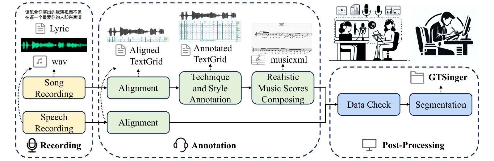

<h1>GTSinger: A Global Multi-Technique Singing Corpus with Realistic Music Scores for All Singing Tasks<br>
  <a href="https://neurips.cc/virtual/2024/poster/97428"></a>
</h1>

<p>
  <strong><a href="https://aaronz345.github.io/">Yu&nbsp;Zhang</a></strong>, Changhao&nbsp;Pan, Wenxiang&nbsp;Guo, Ruiqi&nbsp;Li, Zhiyuan&nbsp;Zhu, Jialei&nbsp;Wang,
  Wenhao&nbsp;Xu, Jingyu&nbsp;Lu, Zhiqing&nbsp;Hong, Chuxin&nbsp;Wang, LiChao&nbsp;Zhang, Jinzheng&nbsp;He,
  Ziyue&nbsp;Jiang, Yuxin&nbsp;Chen, Chen&nbsp;Yang, Jiecheng&nbsp;Zhou, Xinyu&nbsp;Cheng, Zhou&nbsp;Zhao
&ensp;
</p>

<p>
  <a href="https://arxiv.org/abs/2409.13832"></a>
  <a href="https://aaronz345.github.io/GTSingerDemo"></a>
  <a href="https://huggingface.co/datasets/AaronZ345/GTSinger"></a>
  <a href="https://www.vc-challenge.org/"></a>
  <a href="https://mp.weixin.qq.com/s/B1Iqr-24l57f0MslzYEslA"></a>
  <a href="https://mp.weixin.qq.com/s/6RLdUzJM5PItklKUTTNz2w"></a>
  <a href="https://zhuanlan.zhihu.com/p/993933492"></a>
</p>

##  Overview

GTSinger brings together **80.59 hours of singing** and **16.16 hours of paired speech** from **20 singers across 9 languages**. The studio recordings include manual phoneme alignments, annotations for **6 singing techniques**, global style labels, and realistic music scores.

See the [data format](docs/data-format.md) and [preprocessing guide](docs/data-processing.md) to run the [benchmarks](#benchmarks). To cite GTSinger, use the [BibTeX entry](#citations).

##  News

- **2026.09** · Refined annotations for all nine languages.
- **2025.02** · Released all processed data and refined annotations for seven languages.
- **2024.09** · Released the full dataset.
- **2024.09** · GTSinger was accepted to NeurIPS 2024 as a Spotlight.
- **2024.05** · Released the code.

##  Dataset

The full corpus, processed subsets, and refined paired speech are available for download. Annotation refinement for all nine languages was completed in September 2026.

[](https://huggingface.co/datasets/AaronZ345/GTSinger) [](https://drive.google.com/drive/folders/1xcdvCxNAEEfJElt7sEP-xT8dMKxn1_Lz?usp=drive_link)

Use of the corpus is subject to the [dataset license](dataset_license.md).

| Resource | Files |
| --- | --- |
| Full recordings and annotations | WAV audio, TextGrid alignments, per-recording JSON, and MusicXML scores |
| Processed subsets | `metadata.json`, `phone_set.json`, and `spker_set.json` |

### Corpus contents

Each song includes a technique recording, a control recording for comparison, and paired speech. The [data-format guide](docs/data-format.md) explains how the recordings, annotations, and scores are organized.

<p align="center">
  
  <br>
  <sub><a href="https://arxiv.org/html/2409.13832v8#S1.F1">Figure 1</a>. Recordings, alignments, and scores for each song.</sub>
</p>

- **Languages:** Chinese, English, Japanese, Korean, Russian, Spanish, French, German, and Italian.
- **Singing techniques:** Mixed voice, falsetto, breathy, pharyngeal, vibrato, and glissando. Mixed voice and falsetto share a technique directory.
- **Audio:** 48 kHz, 24-bit WAV. The singers span all four vocal ranges.

### Data collection

We aligned both singing and speech. For singing, we also annotated technique and style and prepared realistic music scores before checking and segmenting the data.

<p align="center">
  
  <br>
  <sub><a href="https://arxiv.org/html/2409.13832v8#S3.F2">Figure 2</a>. The GTSinger data collection pipeline.</sub>
</p>

##  Benchmarks

Choose a processed subset and update its audio paths for your machine. Each benchmark guide covers its own environment and configuration.

| Benchmark | Related models |
| --- | --- |
| [Technique-controllable singing voice synthesis](Technique-Controllable%20SVS/readme.md) | [TCSinger](https://github.com/AaronZ345/TCSinger) |
| [Technique recognition](Tech-Recognition/readme.md) | Included benchmark |
| [Style transfer](Style%20Transfer/readme.md) | [StyleSinger](https://github.com/AaronZ345/StyleSinger), [TCSinger](https://github.com/AaronZ345/TCSinger) |
| [Speech-to-singing conversion](STS%20Conversion/readme.md) | [AlignSTS](https://github.com/RickyL-2000/AlignSTS) |

For dataset validation or annotation processing, start with the [preprocessing guide](docs/data-processing.md).

##  Preprocessing

From the repository root:

```bash
git clone https://github.com/AaronZ345/GTSinger.git
cd GTSinger
conda create -n gt_dataprocess python=3.8 -y
conda activate gt_dataprocess
python -m pip install -r Data-Process/requirements.txt
```

| Directory | Purpose |
| --- | --- |
| [Data-Process/check](Data-Process/check) | Validate file layout, bandwidth, duration, F0, and mel spectrograms |
| [Data-Process/process](Data-Process/process) | Convert annotations, add global labels, and segment singing or speech |
| [Data-Process/utils](Data-Process/utils) | Phoneme and alignment utilities |

See the [script guide](docs/data-processing.md) before running preprocessing on a new dataset.

##  Citations

If you find this code useful in your research, please cite our work:
```bib
@article{zhang2024gtsinger,
  title={Gtsinger: A global multi-technique singing corpus with realistic music scores for all singing tasks},
  author={Zhang, Yu and Pan, Changhao and Guo, Wenxiang and Li, Ruiqi and Zhu, Zhiyuan and Wang, Jialei and Xu, Wenhao and Lu, Jingyu and Hong, Zhiqing and Wang, Chuxin and others},
  journal={arXiv preprint arXiv:2409.13832},
  year={2024}
}
```

##  Disclaimer

Any organization or individual is prohibited from using any technology mentioned in this paper to generate someone's singing without his/her consent, including but not limited to government leaders, political figures, and celebrities. If you do not comply with this item, you could be in violation of copyright laws.
